# 8b.is — lantern

**One streaming setup, configured once, held for the whole family.**

Lantern curates which addons are allowed and which filters to prefer, brokers a
short-lived configuration bundle to each device, and keeps one entitlement ledger.
Not a media host. Not a proxy. Configuration as the product.



```
lantern
  ├── keeps the entitlement ledger           (who paid, how many seats)
  ├── curates the addon manifest             (data, not releases)
  └── brokers a configuration bundle         (per device, expiring, no credential)
```

The debrid credential itself is not stored by this service yet. That is the one
piece of the design still ahead of the code, and it is named here rather than
implied by the diagram.

---

## why this exists

The family has nine devices and one streaming setup. Every device holds a slightly
different version of that setup: a different subset of addons, different filters,
different subtitle languages, and nobody knows which one is current. The bytes are
not the problem — a debrid cache already has them. The problem is that
configuration is stored in nine places and edited in none of them.

lantern moves the configuration to one place and makes the *manifest* the artifact.
The cache stays the debrid provider's job, because they are better at it than we
would be and it is not a cost this family should carry.

The honest trade: we depend on a third party for the bytes and cannot fix a stream
that will not start. That dependency is named in
[ADR 0001](docs/adr/0001-broker-and-ledger-not-host.md), not hidden.

---

## the tiers

| tier | EUR / month | seats | what it adds |
|---|---|---|---|
| `free` | 0 | 1 | no configuration bundle, no subtitles |
| `family` | 490 | 5 | configuration bundle, cached-only preferred, HU+EN subtitles |
| `household` | 990 | 12 | everything in family, YouTube addon |
| `patron` | 1900 | 24 | household, 24 seats |

Prices are integer cents in the table (`plans/SPEC.md` is the contract) and are
rendered once, at the edge. `490` is `€4.90`. There is no float anywhere near a
price — [ADR 0002](docs/adr/0002-integer-cents-and-a-data-price-table.md) explains
why that matters when an invoice has to reconcile.

Billed monthly, cancel any time. Every figure is a list price for one month, not
an annualised saving.

---

## how it works

1. **One debrid account.** The family holds a Real-Debrid or TorBox account. When
   the credential broker lands, the token goes into lantern once, server-side, and
   never reaches a device. Until then the token stays in the client, which is the
   arrangement this service exists to replace.
2. **One manifest.** The allowed addons, the preferred filters (`[8B+]` / `[RD+]`
   cached-only — the bundle asks for cached streams and the client is expected to
   honour it), the pinned catalogues, the subtitle languages. Edited in one place,
   applied everywhere.
3. **One bundle per device.** A device asks `/api/bundle` with its email, receives
   a configuration bundle that expires in an hour, and is done. Nine devices, one
   manifest, no per-device fiddling.

Supported clients: Stremio on macOS, Windows, Linux, Android, Android TV, iOS
(PWA), tvOS, Tizen and webOS.

---

## what lantern never does

This is the part worth reading twice.

- **No media hosting.** Not a byte of media is stored here.
- **No P2P by default.** The bundle asks for cached-only streams. Whether a device
  honours that is up to the client, which is not code in this repo: lantern can state
  the rule but cannot enforce it on a player it does not control. A client that
  ignores `cached_only` is not a supported client.
- **No ads.** There is nothing to advertise against; we are not in the attention
  business.
- **No tracking.** The landing page makes no network request other than the
  checkout POST, and the server logs no request bodies.
- **No account required to read the docs.** The manifest and the ADRs are public.

---

## running it

Zero runtime dependencies. Node 26 runs the TypeScript sources directly.

```bash
scripts/verify.sh                 # syntax check every source, then the whole suite
node --test server/test/          # just the suite, offline
node server/src/server.ts         # serves on PORT, default 8787
```

Configuration is environment only: `PORT`, `STRIPE_SECRET_KEY`,
`STRIPE_WEBHOOK_SECRET`, `STRIPE_PRICE_<TIER>`.

**Stripe unconfigured is a supported state.** The checkout seam returns a
deterministic fake URL and the server logs `stripe: unconfigured` once. The webhook
does the opposite: with no secret it rejects every event, because a free service
is worse than a broken one —
[ADR 0003](docs/adr/0003-webhook-fails-closed-and-stripe-behind-one-seam.md).

**The webhook fails closed.** No development bypass, by design. To seed an
entitlement locally, write `server/data/entitlements.json` directly; the store
validates and persists it atomically.

---

## the landing

`landing/index.html`, `landing/landing.css`, `landing/tokens.css`,
`landing/app.js`. Static, no build, no CDN, no external font, and no ES module —
`app.js` is a classic deferred script because a `type="module"` script is blocked
over `file://`, which would break the "open it off the filesystem" promise. Open
`index.html` directly, or serve the directory.

It wears the constellation ink — near-black canvas `#05060a`, mint `#62e6c9`, gold
`#e8b05c`, violet `#b48bff`, cyan `#00f0ff`. The tokens are copied from the 8b.is
design system and the provenance is stated at the top of `tokens.css`; they are not
imported across repos, so this page stands alone
([ADR 0004](docs/adr/0004-static-landing-that-stands-alone.md)).

The tier comparison is rendered from a local copy of the price table. A test in the
server lane compares that copy against `plans.ts` and fails if they diverge, which
is the whole reason the duplication is safe.

---

## the API

Public:

```
GET  /healthz                      200 {ok, version, uptime_s}
GET  /api/plans                    200 {plans:[{id,name,cents,seats,features}]}
POST /api/checkout   {plan, email} 200 {url, session_id}
POST /api/webhook                  Stripe events, HMAC-SHA256 verified
```

Device-facing. `/api/bundle` registers a device on first contact and returns its
secret once; later calls present `Authorization: Bearer <device secret>`. A
first-time device must also pass the family enrolment code as `&enrolment=`.

```
GET    /api/bundle?email=&device=&enrolment=
                                   200 {tier,seats,addons,subtitle_languages,forced_filters,expires_at,device_id,device_secret?}
GET    /api/entitlement?email=    200 {email,plan,seats,status,valid_until,device}   (Bearer <device secret>)
GET    /api/devices?email=        200 {email,seats,used,devices:[{id,name,created_at,last_seen_at}]}   (no auth: inventory only)
DELETE /api/devices?id=           200 {revoked,id}        (Bearer <device secret>)
POST   /api/devices/sweep?email=  200 {swept,ids}         (reclaim seats from devices unseen for 90 days)
```

There is no route that returns a credential, and `GET /api/entitlement` never
returns the enrolment hash: it was a password-equivalent, and it is the reason that
route is authenticated.

Every error is `{error: "<string>"}`. The complete set — a client may branch on
these and on nothing else:

| status | error | when |
|---|---|---|
| 400 | `unknown_plan` | `plan` is not one of the four tiers |
| 400 | `email_required` | `email` is missing or blank (checked after the plan) |
| 400 | `bad_json` | the body is not a JSON object |
| 400 | `bad_signature` | webhook secret unset, header malformed, timestamp stale, or HMAC mismatch |
| 400 | `bad_payload` | signature valid but the body is not JSON |
| 400 | `payload_too_large` | body over 64 KiB |
| 400 | `read_failed` | the request body errored mid-read |
| 400 | `read_timeout` | the body did not arrive within 10 s |
| 400 | `device_required` | a device revoke asked without an id or a secret |
| 401 | `device_secret_required` | a private route was asked for without a device secret |
| 401 | `invalid_device_secret` | a device secret was offered and did not match that email |
| 402 | `payment_required` | bundle asked for a record that is free, lapsed, or past due |
| 403 | `enrolment_required` | a new device registered without a valid family enrolment code |
| 403 | `seat_limit_reached` | every seat is taken and the caller is not a known device |
| 404 | `not_found` | unknown route |
| 404 | `unknown_device` | no device with that id, or the secret does not match |
| 404 | `unknown_entitlement` | no ledger entry for that email |
| 409 | `already_subscribed` | checkout asked for an email whose subscription is active |
| 429 | `rate_limited` | too many bundle requests from this caller; try again shortly |
| 500 | `internal` | anything unhandled |
| 502 | `upstream_failed` | Stripe returned a non-2xx |

Errors are the server's own strings and are rendered verbatim by the client. A
client that paraphrases a server error will eventually paraphrase it wrong.

---

## continuous integration

`.github/workflows/ci.yml` runs two jobs on every push and pull request: syntax plus
the full test suite, and a landing check that fails if the page gains an external
`src`, `href`, `url()`, `@import`, or `fetch()`. The second job is the enforcement
behind the privacy claim above — without it, "makes no request it does not need" is
a sentence, not a property.

## what is deliberately absent

- **The proxy data path.** lantern brokers configuration and entitlements; it does not
  relay bytes. A documented seam, not shipped code.
- **Media storage and transcoding.** Out of scope, permanently.
- **A database.** A JSON file with atomic writes is the right size for a family.
- **A VM, an LSP, an MCP surface.** There is no language here, so there is nothing for
  one to serve.

## layout

```
AGENTS.md                     the rules, for agents and for reviewers
plans/SPEC.md                 the build contract both lanes implement against
docs/ELI5.md                  what it is, for a ten-year-old
docs/adr/0001..0005           broker-not-host, integer cents, fail-closed webhook,
                             static standalone landing, unauthenticated-until-deployed
scripts/verify.sh             syntax check + full suite
scripts/mirror.sh             push both forges, refusing if either is unreachable
server/src/consts.ts          the canonical constants: body cap, port, tolerance, mode
server/src/plans.ts           the tier table — the only place a price lives
server/src/store.ts           entitlement ledger, atomic writes
server/src/stripe.ts          the checkout seam, injectable transport
server/src/manifest.ts        the addon catalogue and the device bundle
server/src/audit.ts           one-line audit trail per entitlement change
server/src/webhook.ts         HMAC verification and event dispatch
server/src/server.ts          the nine route registrations, plus graceful drain
server/test/                  87 offline tests, including README and landing parity
landing/index.html            the page, with Open Graph and Twitter metadata
landing/landing.css           layout and components; defines no colour of its own
landing/tokens.css            constellation ink, copied with provenance
landing/app.js                tier CTAs and error rendering
landing/lantern-mark.svg      the mark: stroke geometry, no gradient, no raster
landing/favicon.svg/.ico      the mark simplified, plus a real 3-size .ico
landing/hero.svg              the hero drawing: lantern, four nodes, one ledger
landing/og-image.html/.png    the 1200x630 social card, and its source
```

---

## status

Built and tested. 139 tests, offline, no network, no runtime dependencies.

| area | state |
|---|---|
| entitlement ledger | atomic JSON writes, fsync before rename, survives restart |
| tier table | four tiers, integer cents, the only place a price is declared |
| addon manifest | six addons, cached-only flagged, served inside the bundle |
| configuration bundle | per device, expires in one hour, never carries a credential |
| Stripe checkout | one injectable seam, real HMAC webhook, fails closed |
| device registry | hashed secrets, one seat per device, persists across restart |
| audit trail | one NDJSON line per entitlement and device change |
| graceful shutdown | drains in-flight grants before exit |

Four things are worth knowing before you trust it with a family:

**A new device must prove it belongs.** Knowing an email is not proof — without the
enrolment code, anyone could fill every seat with junk and lock the family's own
television out. The first grant prints a one-time code, stored hashed, never shown
again.

**Renewals extend; cancellations release.** `invoice.paid` and
`invoice.payment_succeeded` move the expiry forward; ending a subscription releases
that family's devices and keeps the code, so resubscribing works with the same one.

**A replayed webhook is a no-op, but a failed one is retryable.** Stripe delivers at
least once, so processed event ids are recorded. A grant that throws releases its
claim, so the retry can still land — otherwise a full disk would take the money and
grant nothing.

**`/api/bundle` is rate limited.** A sha256 per request plus an fsync per new device
is work an anonymous caller should not be able to schedule. Burst 20, sustained 5 per
second per address, 429 over the line. Not a defence against guessing an enrolment
code, which is 50 bits and not the threat.

Not built: **the credential broker** — nothing here stores a debrid token yet, and
the bundle has no token field, so the day it lands it cannot leak through by accident.
Also not here: a real Stripe account, a real debrid token, a deployed instance, and
a device identity for `GET /api/devices` (inventory only, no auth, no secrets). Those
are operator steps, not code. See
[ADR 0005](docs/adr/0005-unauthenticated-until-deployed.md) for the deployment gate.

Three things this will be judged on, in order: **the webhook does not fail open**,
**a price is never a float**, and **the landing makes no request it does not need**.

---

## where it lives

| Forge | URL | State |
|---|---|---|
| GitHub | <https://github.com/8b-is/lantern> | live |
| Codeberg | <https://codeberg.org/8b-is/lantern> | live |

Both carry the same `main`, and neither is authoritative over the other.

```bash
scripts/mirror.sh        # reachability check, then push both, then print all three SHAs
```

---

*8b.is · lantern · fine touch from within · AGPL-3.0-only*